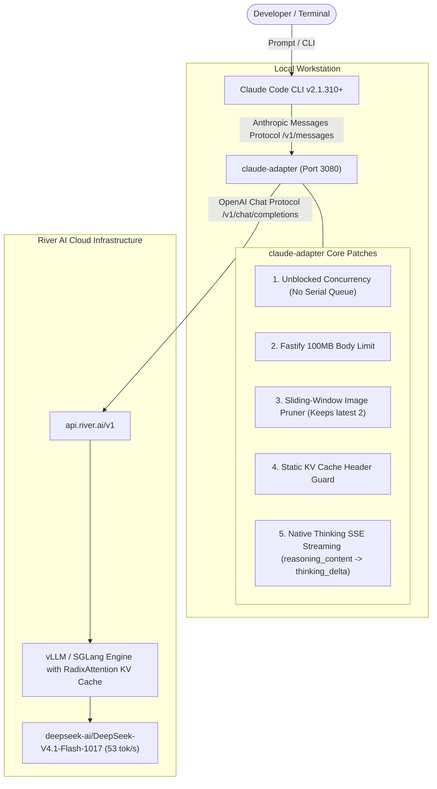

# The Maximum Intelligence + Maximum Speed Stack
### The Complete Architecture, Configuration, and Blueprint for Claude Code + River AI DeepSeek

This document is the master blueprint and reference guide for the **Maximum Intelligence + Maximum Speed** stack. It contains every configuration, source patch, environment variable, and protocol required to reproduce or install this exact setup on any project or machine.

---

## 1. System Architecture



---

## 2. Why This Specific Stack?

| Requirement | Traditional Setup Problem | How Our Stack Solves It |
| :--- | :--- | :--- |
| **Maximum Intelligence** | Models without deep reasoning hallucinate on edge cases; shallow effort cuts off chain-of-thought proofs. | Pegged at `effortLevel: "xhigh"` and `reasoning_effort: "max"`. Allocates up to 64,000 thinking tokens with zero-shot deterministic code output (`temperature: 0.0`). |
| **Maximum Speed** | Frontier 671B models take 25–45s before producing text (10–15 tok/s). | `DeepSeek-V4.1-Flash-1017` delivers **~53 tokens/second sustained** with sub-second TTFT (<1.5s). |
| **Zero Protocol Friction** | Direct Anthropic calls to River AI fail because River AI uses OpenAI format. | Local `claude-adapter` acts as a zero-latency protocol translator on `127.0.0.1:3080`. |
| **No 32MB Request Deadlocks** | Screenshots and media accumulate in history, triggering `Request too large (max 32MB)` and breaking `/compact`. | Client limit raised to 64MB (`tengu_wobbly_fern`), adapter Fastify buffer raised to 100MB, and sliding-window pruning retains only active screenshots. |
| **Zero Context Loss** | Running `/clear` wipes in-memory turns, forcing tedious re-prompting. | `PROGRESS.md` and `CLAUDE.md` Resumption Protocol allow instant continuation with a single word (`resume`). |

---

## 3. Global Machine Configurations (One-Time Setup)

### A. Claude Adapter Configuration (`~/.claude-adapter/config.json`)
Located at: `C:\Users\<Username>\.claude-adapter\config.json`

```json
{
  "baseUrl": "https://api.river.ai/v1",
  "apiKey": "YOUR_RIVER_AI_API_KEY",
  "models": {
    "opus": "deepseek-ai/DeepSeek-V4.1-Flash-1017",
    "sonnet": "deepseek-ai/DeepSeek-V4.1-Flash-1017",
    "haiku": "deepseek-ai/DeepSeek-V4.1-Flash-1017",
    "vision": "deepseek-ai/DeepSeek-V4.1-Flash-1017"
  },
  "toolFormat": "native",
  "port": 3080,
  "proxyAuthToken": "claude-adapter-river-token"
}
```

### B. Global Claude Settings (`~/.claude/settings.json`)
Located at: `C:\Users\<Username>\.claude\settings.json`

```json
{
  "env": {
    "ANTHROPIC_BASE_URL": "http://127.0.0.1:3080",
    "ANTHROPIC_AUTH_TOKEN": "claude-adapter-river-token",
    "ANTHROPIC_MODEL": "claude-sonnet-5",
    "ANTHROPIC_DEFAULT_MODEL": "claude-sonnet-5",
    "ANTHROPIC_DEFAULT_OPUS_MODEL": "claude-sonnet-5",
    "ANTHROPIC_DEFAULT_SONNET_MODEL": "claude-sonnet-5",
    "ANTHROPIC_DEFAULT_HAIKU_MODEL": "claude-sonnet-5",
    "ANTHROPIC_SMALL_FAST_MODEL": "claude-sonnet-5",
    "CLAUDE_CODE_SUBAGENT_MODEL": "claude-sonnet-5",
    "API_TIMEOUT_MS": "3000000",
    "CLAUDE_CODE_USE_POWERSHELL_TOOL": "1",
    "CLAUDE_CODE_SHELL": "powershell.exe",
    "CLAUDE_CODE_EXPERIMENTAL_AGENT_TEAMS": "1",
    "CLAUDE_CODE_MAX_TOOL_OUTPUT": "50000",
    "NO_UPDATE_NOTIFIER": "1",
    "CLAUDE_CODE_DISABLE_TELEMETRY": "1",
    "DISABLE_TELEMETRY": "1"
  },
  "permissions": {
    "defaultMode": "auto",
    "allow": [
      "Bash(npm run *)",
      "Bash(git status*)",
      "Bash(git diff*)",
      "Bash(git log*)",
      "Bash(npx tsc*)",
      "PowerShell(npm run *)",
      "PowerShell(git status*)",
      "PowerShell(git diff*)",
      "PowerShell(git log*)",
      "PowerShell(npx tsc*)"
    ]
  },
  "model": "claude-sonnet-5",
  "modelPicker": {
    "options": [
      {
        "model": "claude-sonnet-5",
        "label": "DeepSeek-V4.1-Flash-1017 (River AI)",
        "description": "DeepSeek-V4.1-Flash-1017 on River AI via Claude Adapter (Max Speed & High Reasoning)"
      }
    ],
    "replaceBuiltInOptions": true
  },
  "permissions": {
    "defaultMode": "bypassPermissions"
  },
  "skipDangerousModePermissionPrompt": true,
  "skipWorkflowUsageWarning": true,
  "modelSettings": {
    "claude-sonnet-5": {
      "effortLevel": "xhigh",
      "autoCompactWindow": 200000
    }
  },
  "enabledPlugins": {
    "cc-plugin-telemetry@builtin": false,
    "cc-plugin-plugin-authoring@builtin": false
  }
}
```

### C. Client-Side 64MB Headroom (`~/.claude.json`)
Located at: `C:\Users\<Username>\.claude.json`
Inside the `"cachedGrowthBookFeatures"` object, add:

```json
"cachedGrowthBookFeatures": {
  "tengu_wobbly_fern": 67108864
}
```
*(Overrides the hardcoded 32MB client check, raising client request ceiling to 64MB).*

### D. Global Git Speed Optimizations
Run once in PowerShell:
```powershell
git config --global core.fscache true
git config --global core.preloadindex true
```

---

## 4. Claude-Adapter Engine Patches

The adapter lives in:
`%APPDATA%\npm\node_modules\claude-adapter\dist\`

### Patch 1: Fastify 100MB Body Ingestion (`server/index.js`)
At line 54:
```javascript
// BEFORE: const app = (0, fastify_1.default)({ logger: false });
// AFTER:
const app = (0, fastify_1.default)({ logger: false, bodyLimit: 104857600 });
```

### Patch 2: Unblocked Parallel Concurrency (`server/handlers.js`)
Remove the serial `enqueue(...)` wrapper so parallel Agent Teams / subagents execute concurrently against River AI without waiting in an artificial single-file queue.

### Patch 3: Streaming Reasoning SSE Translation (`converters/streaming.js`)
Intercept `chunk.choices[0].delta.reasoning_content` or `delta.reasoning` from DeepSeek and stream Anthropic SSE events:
```javascript
const reasoning = delta?.reasoning_content || delta?.reasoning;
if (reasoning) {
    if (!state.thinkingBlockOpen) {
        sendContentBlockStart(state.contentBlockIndex, 'thinking', '', raw);
        state.thinkingBlockOpen = true;
    }
    state.thinkingContent += reasoning;
    sendThinkingDelta(state.contentBlockIndex, reasoning, raw);
}
// Cleanly close thinking block before text or tool calls
if ((delta.content || delta.tool_calls || choice.finish_reason) && state.thinkingBlockOpen) {
    sendContentBlockStop(state.contentBlockIndex, raw);
    state.thinkingBlockOpen = false;
    state.contentBlockIndex++;
}
```

### Patch 4: Sliding-Window Image Pruner (`converters/request.js`)
Prevents multi-turn browser testing from bloating the context window or tripping payload limits:
```javascript
const inputMessages = anthropicRequest.messages.map(m => Array.isArray(m.content) ? { ...m, content: [...m.content] } : m);
const imageLocations = [];
for (let mIdx = 0; mIdx < inputMessages.length; mIdx++) {
    const msg = inputMessages[mIdx];
    if (Array.isArray(msg.content)) {
        for (let cIdx = 0; cIdx < msg.content.length; cIdx++) {
            const b = msg.content[cIdx];
            if (b && (b.type === 'image' || b.type === 'image_url')) {
                imageLocations.push({ mIdx, cIdx });
            }
        }
    }
}
// Retain full images for only the 2 most recent turns; prune older historical images
if (imageLocations.length > 2) {
    const toPrune = imageLocations.slice(0, imageLocations.length - 2);
    for (const loc of toPrune) {
        inputMessages[loc.mIdx].content[loc.cIdx] = {
            type: 'text',
            text: '[Screenshot from earlier turn: UI state verified and passed]'
        };
    }
}
```

### Patch 5: Reasoning Effort & Calibrated Entropy (`converters/request.js`)
```javascript
// Calibrated entropy: DeepSeek recommends 0.3-0.5 to avoid degenerative token repetition loops
// while preserving razor-sharp code syntax and deterministic logic.
openaiRequest.temperature = (anthropicRequest.temperature !== undefined && anthropicRequest.temperature > 0) 
    ? anthropicRequest.temperature 
    : 0.3;

// Map Anthropic thinking budget to River AI reasoning_effort
if (anthropicRequest.thinking && anthropicRequest.thinking.type === 'enabled') {
    const budget = anthropicRequest.thinking.budget_tokens ?? 0;
    openaiRequest.reasoning_effort = budget >= 16000 ? 'max' : 'high';
}

// Neutralize system prompt modifier to keep prefix byte-identical for KV caching
function modifySystemPromptForClaudeAdapter(systemContent) {
    return systemContent;
}
```

### Patch 6: Automatic Tool Loop Breaker (`converters/request.js`)
Detects when the model repeats an identical tool call from recent turns and injects a feedback warning into the tool result to break greedy decoding attractors:
```javascript
const assistantTurns = inputMessages.filter(m => m.role === 'assistant' && Array.isArray(m.content));
if (assistantTurns.length >= 2) {
    const lastTurn = assistantTurns[assistantTurns.length - 1];
    const lastToolCalls = lastTurn.content.filter(b => b && b.type === 'tool_use');
    if (lastToolCalls.length > 0) {
        const prevTurns = assistantTurns.slice(Math.max(0, assistantTurns.length - 3), assistantTurns.length - 1);
        for (const lastCall of lastToolCalls) {
            const isRepeated = prevTurns.some(pt => 
                Array.isArray(pt.content) && pt.content.some(pb => 
                    pb && pb.type === 'tool_use' && pb.name === lastCall.name && JSON.stringify(pb.input) === JSON.stringify(lastCall.input)
                )
            );
            if (isRepeated) {
                for (const m of inputMessages) {
                    if (m.role === 'user' && Array.isArray(m.content)) {
                        for (const b of m.content) {
                            if (b && b.type === 'tool_result' && b.tool_use_id === lastCall.id) {
                                const warning = '\n\n[Loop Breaker Warning: You have already executed this identical command with the exact same arguments and received the output above. DO NOT repeat this command. Switch approach, inspect differently, or proceed directly with the edit.]';
                                if (typeof b.content === 'string') b.content += warning;
                                else if (Array.isArray(b.content)) b.content.push({ type: 'text', text: warning });
                            }
                        }
                    }
                }
            }
        }
    }
}
```

### How to Run the Adapter as a Daemon
```powershell
node "C:\Users\<Username>\AppData\Roaming\npm\node_modules\claude-adapter\dist\cli.js" --no-claude-settings
```

---

## 5. Per-Project Scaffolding Checklist

For any new or existing repository, add these 4 files to the project root:

### File 1: `.claude/settings.json`
```json
{
  "env": {
    "ANTHROPIC_BASE_URL": "http://127.0.0.1:3080",
    "ANTHROPIC_AUTH_TOKEN": "claude-adapter-river-token",
    "ANTHROPIC_MODEL": "claude-sonnet-5",
    "ANTHROPIC_DEFAULT_MODEL": "claude-sonnet-5",
    "ANTHROPIC_DEFAULT_OPUS_MODEL": "claude-sonnet-5",
    "ANTHROPIC_DEFAULT_SONNET_MODEL": "claude-sonnet-5",
    "ANTHROPIC_DEFAULT_HAIKU_MODEL": "claude-sonnet-5",
    "ANTHROPIC_SMALL_FAST_MODEL": "claude-sonnet-5",
    "CLAUDE_CODE_SUBAGENT_MODEL": "claude-sonnet-5",
    "API_TIMEOUT_MS": "3000000",
    "CLAUDE_CODE_USE_POWERSHELL_TOOL": "1",
    "CLAUDE_CODE_SHELL": "powershell.exe",
    "CLAUDE_CODE_EXPERIMENTAL_AGENT_TEAMS": "1",
    "CLAUDE_CODE_MAX_TOOL_OUTPUT": "50000",
    "NO_UPDATE_NOTIFIER": "1",
    "CLAUDE_CODE_DISABLE_TELEMETRY": "1",
    "DISABLE_TELEMETRY": "1"
  },
  "permissions": {
    "defaultMode": "bypassPermissions",
    "allow": [
      "Bash(npm run *)",
      "Bash(git status*)",
      "Bash(git diff*)",
      "Bash(git log*)",
      "Bash(npx tsc*)",
      "PowerShell(npm run *)",
      "PowerShell(git status*)",
      "PowerShell(git diff*)",
      "PowerShell(git log*)",
      "PowerShell(npx tsc*)"
    ]
  },
  "model": "claude-sonnet-5",
  "modelPicker": {
    "options": [
      {
        "model": "claude-sonnet-5",
        "label": "DeepSeek-V4.1-Flash-1017 (River AI)",
        "description": "DeepSeek-V4.1-Flash-1017 on River AI via Claude Adapter (Max Speed & High Reasoning)"
      }
    ],
    "replaceBuiltInOptions": true
  },
  "modelSettings": {
    "claude-sonnet-5": {
      "effortLevel": "xhigh",
      "autoCompactWindow": 50000
    }
  }
}
```

### File 2: `.claudeignore`
```gitignore
# Dependencies & Virtualenvs
node_modules/
.venv/
venv/
.pnpm-store/

# Build & Distribution Artifacts
dist/
build/
.next/
.expo/
*.tsbuildinfo
*.map

# Large Binaries & Archive Dumps
*.pdf
*.docx
*.zip
*.tar.gz
*.png
*.jpg
*.jpeg
*.webp
*.ico

# Lockfiles
package-lock.json
pnpm-lock.yaml
yarn.lock
bun.lockb

# Scratch, Tool States & Cache
.artifacts/
.claude-flow/
.swarm/
.qodo/
.secrets/
.turbo/
.cache/
*.log
```

### File 3: `CLAUDE.md`
```markdown
@AGENTS.md

# DeepSeek Reasoning & High-Performance Directives

## 1. Deep Reasoning Focus
- Prioritize your internal reasoning budget on:
  - Root cause analysis and core problem diagnosis.
  - Architecture, state flow, and data contracts.
  - Edge cases, type safety, and concurrency/race conditions.
- Do not waste reasoning tokens on routine syntax or pleasantries.

## 2. Context Window & Speed Preservation (Strict)
- **Targeted File Inspection:** Specify targeted line ranges (`StartLine` and `EndLine`) instead of dumping entire large files.
- **Selective Searching:** Use precise regex/pattern grep searches instead of broad directory dumps.
- **No Redundant Reads:** Do not re-read files that were already viewed or edited in recent turns.
- **Compact Tool Outputs:** Run CLI commands with quiet flags (`git diff --stat`, etc.) to keep KV cache 95%+ hot.

## 3. High-Throughput Execution
- **Batching:** Execute edits and validations in coordinated, composite turns.
- **Concise Responses:** Deliver direct, concise summaries highlighting key decisions and diffs.

## 4. Web UI & Live Browser Verification
- **DOM-First Verification:** When verifying application routes or component behavior with browser/Playwright tools, prioritize accessibility tree snapshots and DOM evaluation (`browser_snapshot` / `browser_evaluate`). These verify UI state, forms, and routes with 100% semantic accuracy in under 2KB of text.
- **Selective Visual Screenshots:** Only capture full visual screenshots when explicitly validating styling, layout, or color aesthetics. Avoid taking multiple consecutive full-page screenshots in a single session.

## 5. Continuity & Resumption Protocol (Zero Context Loss Across /clear)
- **Automatic State Recovery:** Whenever the user says "resume", "continue", "what's next", or starts a turn after `/clear`:
  1. Inspect `PROGRESS.md` and active plans in `.claude/plans/`.
  2. Run `git status` and `git log -n 3 --oneline` (plus `git branch -a`) to reconcile the current repo state against `PROGRESS.md`.
  3. State the current milestone in one concise sentence and immediately execute the next pending step autonomously.
- **Maintain PROGRESS.md:** Whenever a milestone, wave, or stream finishes or commits, update `PROGRESS.md` with:
  - What was just completed (commit hash, verified tests).
  - The exact next pending action.
```

### File 4: `PROGRESS.md`
```markdown
# Project Progress & State Tracker

This file serves as the ground-truth state anchor across Claude Code sessions, restarts, and `/clear` invocations.

---

## 1. Active Plan & Roadmap
- **Active Plan:** [Name / Path of Plan]
- **Current Milestone:** [Milestone Description]

---

## 2. Git & Branch State
- **Active Branch:** `[Branch Name]`
- **Latest Commits:** `[Hash]` - [Commit message]
- **Status:** [Build & Test Status]

---

## 3. Immediate Next Steps (To Execute on Resume)
1. [Task 1]
2. [Task 2]
```

---

## 6. Daily Workflow Cheatsheet

### Starting a Task
1. Press **`Shift + Tab`** in Claude Code to enter **Plan Mode**.
2. Have DeepSeek run at `xhigh` to architect and verify edge cases without making code edits.
3. Switch back to normal mode and instruct Claude to implement the plan.

### If Context Ever Feels Heavy or Slow
1. Type:
   ```text
   /clear
   ```
2. Then simply type:
   ```text
   resume
   ```
Claude will read `PROGRESS.md`, check git, and immediately continue where it left off with 0 tokens of baggage and maximum speed.
